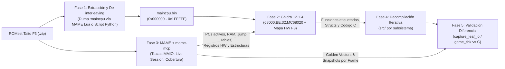

# Plan Maestro de Decompilación — Taito F3 (`Taitof3Decomp`)

Plan de ingeniería inversa y decompilación para ROMs del sistema arcade **Taito F3** (CPU principal **Motorola MC68EC020**), combinando **análisis estático en Ghidra 12.1.4** con **análisis dinámico y validación diferencial vía `astrobleem/mame-mcp` sobre MAME**.

> **Referencia de hardware complementaria:** [`docs/TAITO_F3_HW_MAP.md`](docs/TAITO_F3_HW_MAP.md)  
> **Plantilla MCP:** [`.mcp.json.example`](.mcp.json.example)

---

## 1. Arquitectura del Flujo de Trabajo

El principio rector es un **bucle cerrado entre análisis estático y oráculo dinámico**: Ghidra produce el grafo de llamadas y pseudo-C del binario MC68EC020, mientras `mame-mcp` ejecuta la ROM real en MAME para resolver direcciones MMIO, tablas de salto indirectas, código descomprimido en RAM y verificar funciones decompiladas mediante *golden vectors*.



---

## 2. Inventario del Entorno Local (Estado Actual)

Verificación realizada en el host actual (Arch Linux):

| Componente | Estado | Ubicación / Acción requerida |
|---|---|---|
| **Ghidra 12.1.4 PUBLIC** | Disponible | `/home/danimanx/opt/ghidra_12.1.4_PUBLIC` (`analyzeHeadless` y `pyghidraRun` verificados; idioma `68000:BE:32:MC68020` confirmado; JDK 21 en `/usr/lib/jvm/java-21-openjdk`) |
| **Python 3 / `uv` / `git` / `node`** | Disponible | `/usr/bin/python3`, `/usr/bin/uv`, `/usr/bin/git`, `/usr/bin/node` |
| **`astrobleem/mame-mcp`** | Instalado y configurado en Hermes | `/PROCESOS/Taitof3Decomp/tools/mame-mcp` (`.venv`, 31 herramientas activas en `~/.hermes/config.yaml` bajo `mame-mcp`) |
| **`clearbluejar/pyghidra-mcp`** | Instalado y configurado en Hermes | `/PROCESOS/Taitof3Decomp/tools/pyghidra-mcp` (`.venv` Python 3.12, 20 herramientas activas en `~/.hermes/config.yaml` bajo `pyghidra-mcp`, proyecto inicializado en `ghidra_proj/taito_f3`) |
| **MAME (stock)** | Pendiente (`sudo`) | No detectado en `PATH`. Instalar con `sudo pacman -S mame` (paquete `extra/mame 0.289-1`) |
| **ROMset Taito F3 objetivo** | Pendiente | Ubicar `.zip` del juego (y `taito_f3.zip` si aplica BIOS/parent) en `roms/` |
| **Toolchain M68K (`m68k-elf-gcc` / `vasm`)** | Opcional | Solo necesario si el objetivo final es **decompilación *matching* byte-a-byte** en lugar de **decompilación legible / recompilación nativa a C** |

---

## 3. Fases del Plan

### Fase 0 — Preparación del Entorno y Conexión `mame-mcp`

**Objetivo:** Tener MAME stock operativo, `mame-mcp` instalado y validado por el cliente MCP, y la estructura del proyecto lista.

1. **Crear estructura de trabajo** dentro de `/PROCESOS/Taitof3Decomp` (ver Sección 5).
2. **Instalar MAME stock:**
   ```bash
   sudo pacman -S mame
   mame -version
   ```
3. **Instalar `astrobleem/mame-mcp` en un entorno aislado:**
   ```bash
   git clone https://github.com/astrobleem/mame-mcp.git /PROCESOS/Taitof3Decomp/tools/mame-mcp
   cd /PROCESOS/Taitof3Decomp/tools/mame-mcp
   uv venv .venv && source .venv/bin/activate
   uv pip install -e .
   mame-mcp-tools --names
   ```
4. **Configurar el servidor MCP:**
   - Copiar `.mcp.json.example` a `.mcp.json` ajustando `command` al binario `.venv/bin/mame-mcp-bridge`, `MAME_EXE`, `MAME_SYSTEM` (short name del juego en MAME, ej. `dariusg`, `pbobble2`, `elvactr`, `bublbob2`, `gunlock`) y `MAME_ROMPATH` (`/PROCESOS/Taitof3Decomp/roms`).
   - Reiniciar el cliente MCP.
5. **Gate de verificación (Fase 0):**
   - Llamar `ping` → respuesta OK del bridge.
   - Llamar `config_check` → `MAME_EXE` y `MAME_ROMPATH` resueltos correctamente.
   - Llamar `audit_romset` con el `system` objetivo → ROMset validado sin archivos faltantes ni CRC corrupto.

---

### Fase 1 — Adquisición y Reconstrucción del Binario 68EC020

**Objetivo:** Obtener una imagen plana, contigua y verificada de la ROM del procesador principal (`maincpu`, espacio `0x000000`–`0x1FFFFF`, hasta 2 MiB) y, opcionalmente, de la CPU de sonido (`taito_en:audiocpu`).

> **Particularidad de Taito F3:** Debido al bus de datos de 32 bits big-endian del MC68EC020, la mayoría de los juegos Taito F3 almacenan el programa en **4 EPROMs entrelazadas por byte** (`ROM_LOAD32_BYTE` en offsets `+0, +1, +2, +3`) o en pares de 16 bits (`ROM_LOAD32_WORD`). Un error en el orden de entrelazado corrompe todo el desensamblado.

1. **Método recomendado (Cero errores — Dump desde MAME vía `mame-mcp`):**
   - Usar `run_lua_inline` para volcar directamente la región de memoria `:maincpu` ya cargada, mapeada y desentrelazada por el propio driver `taito_f3.cpp` de MAME hacia `work/maincpu.bin` (y `:taito_en:audiocpu` hacia `work/audiocpu.bin`).
2. **Método reproducible offline (Script Python):**
   - Implementar `scripts/reconstruct_rom.py` leyendo la definición de ROMs del driver (o `mame -listxml <system>`) para desentrelazar los archivos del `.zip` y comparar su SHA-256 contra el dump de MAME. Ambos deben coincidir 100%.
3. **Validación de cabecera M68K (`0x000000`–`0x0000FF`):**
   - Verificar que `0x000000` contiene un **Initial SSP** válido dentro de Work RAM (`0x400000`–`0x41FFFF`, usualmente cerca de `0x41FFxx` o `0x420000`).
   - Verificar que `0x000004` contiene un **Initial PC (Reset)** válido dentro de ROM (`0x000100`–`0x1FFFFF`, dirección par).
   - Extraer los punteros de interrupción críticos de Taito F3:
     - `0x000068` → **IRQ Level 2** (VBlank principal, ~58.94 Hz).
     - `0x00006C` → **IRQ Level 3** (Señal diferida +10,000 ciclos tras VBlank).
     - `0x000074` → **IRQ Level 5** (Timer/pseudo-HBlank si el juego escribe en `0x4C0000`).
     - `0x000080`–`0x0000BC` → **TRAP #0..#15** (muchos juegos Taito usan `TRAP` como syscalls internas).

**Gate de verificación (Fase 1):** `work/maincpu.bin` tiene tamaño exacto esperado, checksum reproducible y tabla de vectores M68K coherente.

---

### Fase 2 — Bootstrap Estático en Ghidra 12.1.4

**Objetivo:** Crear un proyecto Ghidra limpio, automatizado y pre-etiquetado con el mapa de memoria completo del hardware Taito F3 para que el descompilador genere pseudo-C legible desde el minuto uno.

1. **Importación Headless con el procesador exacto:**
   ```bash
   /home/danimanx/opt/ghidra_12.1.4_PUBLIC/support/analyzeHeadless \
     /PROCESOS/Taitof3Decomp/ghidra_proj taito_f3 \
     -import /PROCESOS/Taitof3Decomp/work/maincpu.bin \
     -loader BinaryLoader \
     -loader-baseAddr 0x00000000 \
     -processor 68000:BE:32:MC68020 \
     -postScript setup_taito_f3.py
   ```
2. **Script de inicialización (`scripts/ghidra/setup_taito_f3.py`):**
   Automatizar las tareas repetitivas en Ghidra:
   - Crear todos los bloques de memoria no inicializados (RAM/MMIO) según `docs/TAITO_F3_HW_MAP.md`:
     - `WORK_RAM` (`0x400000`–`0x41FFFF`, R/W) y opcionalmente anotar mirror `0x420000`–`0x43FFFF`.
     - `PALETTE_RAM` (`0x440000`–`0x447FFF`, R/W, volatile).
     - `F3_CTRL_IO` (`0x4A0000`–`0x4A001F`, R/W, volatile).
     - `F3_TIMER_CTRL` (`0x4C0000`–`0x4C0003`, W, volatile).
     - `SPRITE_RAM` (`0x600000`–`0x60FFFF`, R/W, volatile).
     - `PF_RAM` (`0x610000`–`0x61BFFF`), `TEXT_RAM` (`0x61C000`–`0x61DFFF`), `CHAR_RAM` (`0x61E000`–`0x61FFFF`).
     - `LINE_RAM` (`0x620000`–`0x62FFFF`), `PIVOT_RAM` (`0x630000`–`0x63FFFF`).
     - `VIDEO_CTRL_0` (`0x660000`–`0x66000F`), `VIDEO_CTRL_1` (`0x660010`–`0x66001F`).
     - `SOUND_DPRAM` (`0xC00000`–`0xC007FF`), `SOUND_RESET_0` (`0xC80000`–`0xC80003`), `SOUND_RESET_1` (`0xC80100`–`0xC80103`).
     - `SOUND_BANK` (`0x300000`–`0x30007F`, si aplica).
   - Tipar la tabla de vectores (`0x000000`–`0x0000FF`) como punteros de 32 bits y crear funciones automáticamente en `Reset`, `IRQ2_VBlank`, `IRQ3_VideoSync`, `IRQ5_Timer` y todos los `TRAP_x` no nulos.
   - Aplicar convención de nombres y etiquetas simbólicas a los registros MMIO (`REG_WATCHDOG`, `REG_COIN_CTRL`, `REG_EEPROM`, `REG_VIDEO_CTRL0`, etc.).
3. **Resolución de convenciones M68K:**
   - Identificar en las primeras 10 funciones el compilador original (o si fue escrito en ensamblador puro M68K: los juegos Taito F3 de los 90 suelen ser **ensamblador puro o C con paso de parámetros por registros `D0-D3`/`A0-A3`**, lo cual requiere configurar *Custom Storage* en Ghidra cuando el ABI estándar en pila no encaja).

**Gate de verificación (Fase 2):** El grafo de llamadas desde `Reset` e `IRQ2_VBlank` se resuelve limpiamente en Ghidra con referencias cruzadas (XREFs) visibles hacia `F3_CTRL_IO`, `SPRITE_RAM`, `PF_RAM` y `SOUND_DPRAM`.

---

### Fase 3 — Descubrimiento Dinámico y Cartografía con `mame-mcp`

**Objetivo:** Usar MAME vivo para mapear código real vs. datos, identificar qué PCs controlan cada subsistema de hardware y levantar el mapa de variables globales en Work RAM (`0x400000`–`0x41FFFF`).

1. **Descubrimiento de entradas (`get_ioports`):**
   - Listar los campos exactos de `IN.0`..`IN.5` (Coin, Start, P1/P2 buttons, Service, Test) para automatizar secuencias reproducibles de arranque y juego.
2. **Trazado MMIO por subsistema (`trace_memory_access`):**
   - Ejecutar barridos dedupados de `(R/W, PC, addr, range)` durante el boot + attract mode + inicio de partida usando los rangos definidos en `docs/TAITO_F3_HW_MAP.md`:
     - **Barrido A (Sistema/I/O):** `0x4A0000..0x4A001F` y `0x4C0000..0x4C0003` → ubica instantáneamente el lector de controles, el reset de watchdog, la lectura de EEPROM y la configuración del timer.
     - **Barrido B (Video/Sprites/Paleta):** `0x440000..0x447FFF`, `0x600000..0x63FFFF`, `0x660000..0x66001F` → ubica los motores de DMA/copia de sprites, actualización de scroll/line-RAM y fades de paleta.
     - **Barrido C (Audio DPRAM):** `0xC00000..0xC007FF` y `0xC80000..0xC80103` → ubica el protocolo de envío de comandos musicales/SFX al 68000 de sonido (`taito_en`).
   - Guardar los reportes JSON en `traces/mmio/` e importarlos como comentarios/bookmarks en Ghidra mediante un script (`scripts/ghidra/import_traces.py`).
3. **Sesión viva para estados y tablas de salto (`mame_launch` + suite live):**
   - Usar `mame_drive_to_gameplay` (o `mame_run_frames` + `mame_send_input`) y `mame_save_state` para crear *savestates* canónicos en `states/`:
     - `00_post_boot.sta` (fin de POST / checksum OK)
     - `01_attract.sta` (pantalla de título)
     - `02_stage1_start.sta` (primer frame jugable)
     - `03_active_combat.sta` (múltiples entidades/sprites activos)
   - Usar `mame_exec_lua_live` para instalar taps temporales que registren:
     - **Cobertura de ejecución (Code vs Data):** lista de bloques básicos/PCs ejecutados para separar código real de tablas de niveles/paletas/mapas embebidos en ROM.
     - **Destinos de saltos indirectos:** capturar pares `(PC_jump, target_PC)` en instrucciones `JMP (An)` / `JSR (d8,PC,Xn)` (máquinas de estado de entidades y escenas) para alimentar manualmente las tablas de salto que Ghidra no deduce estáticamente.
     - **Búsqueda diferencial de Work RAM:** usar `mame_read_memory` sobre `0x400000`–`0x41FFFF` entre frames consecutivos (con `mame_run_frames` y `mame_send_input`) para localizar punteros de frame counter, estado global, coordenadas del jugador, pool de objetos/entidades, vidas, score y RNG.

**Gate de verificación (Fase 3):** Existen trazas JSON por subsistema en `traces/`, savestates reproducibles en `states/` y un catálogo inicial `docs/RAM_MAP.md` con al menos los buffers y variables principales de Work RAM.

---

### Fase 4 — Decompilación Iterativa por Subsistemas (Loop Ghidra ↔ `mame-mcp`)

**Objetivo:** Decompilar, documentar y estructurar el código C de forma ordenada, de abajo hacia arriba (capa de hardware → bucle principal → lógica de juego).

#### Orden recomendado de ataque

| Prioridad | Subsistema | Qué identificar y decompilar | Herramienta clave |
|---|---|---|---|
| **1** | **Boot, POST y Runtime Base** | Inicialización de pila, limpieza de Work RAM, test de checksum ROM (si existe), utilidades `memcpy`/`memset`/RNG/matemática fija (`sin`/`cos`, multiplicación 32-bit `MULS.L`/`DIVS.L` propia del 68020) | Ghidra + `00_post_boot.sta` |
| **2** | **Interrupciones y Frame Scheduler** | `IRQ2_VBlank`, `IRQ3_VideoSync`, `IRQ5_Timer`, contadores de frame, sincronización main-loop vs VBlank, watchdog | `trace_memory_access` + `mame_get_regs` |
| **3** | **Input, Coins y EEPROM** | Lectura de `0x4A0000..0x4A0017`, debouncing/edge-detection (pressed / held / released), lectura/escritura serial 93C46 (`0x4A0010`) | `get_ioports` + `mame_send_input` |
| **4** | **Capa de Video Taito F3** | Abstracción de `SPRITE_RAM` (`0x600000`), `PF_RAM` (`0x610000`), `TEXT_RAM` (`0x61C000`), `LINE_RAM` (`0x620000`), `PIVOT_RAM` (`0x630000`), `PALETTE_RAM` (`0x440000`) y registros `0x660000..0x66001F` | Trazas MMIO + lectura de `taito_f3_v.cpp` de MAME |
| **5** | **Interfaz de Audio (`taito_en`)** | Cola de comandos de sonido hacia `SOUND_DPRAM` (`0xC00000`–`0xC007FF`) y secuencia de reset (`0xC80000`/`0xC80100`). *(La decompilación interna del 68000 de sonido se mantiene como fase secundaria opcional)* | `trace_memory_access` en `0xC00000` |
| **6** | **Máquina de Estados Global y Entidades** | Dispatcher de escenas (Title / Demo / Gameplay / Game Over), estructura del pool de entidades (tamaño de slot, tabla de punteros a funciones de actualización/render), física y colisiones | `mame_exec_lua_live` (taps de jump tables) + diffs de Work RAM |
| **7** | **Lógica de Niveles, Enemigos y Datos** | Scripts de oleadas/eventos, parseo de mapas/tilemaps en ROM, IA de enemigos y jefes | Ghidra + inspección de ROM data |

#### Regla de trabajo por función
1. Localizar función en Ghidra y confirmar su ejecución real y argumentos en MAME (`mame_get_regs` / `mame_read_memory`).
2. Definir en Ghidra firma exacta (incluyendo registros M68K usados), tipos `struct` de Work RAM y nombres semánticos.
3. Exportar / reescribir la función limpia en `src/<subsistema>/` conservando en comentario su dirección ROM exacta (ej. `/* ROM: 0x001A4C */`).
4. Registrar avance en `docs/PROGRESS.md` (estado: `TODO` / `MAPPED` / `DECOMPILED` / `VERIFIED`).

---

### Fase 5 — Validación Diferencial contra MAME (Oráculo de Verdad)

**Objetivo:** Garantizar que el código C decompilado es funcionalmente equivalente al binario MC68EC020 original antes de escalar a todo el juego.

1. **Verificación de funciones hoja (*leaf functions*):**
   - Usar `capture_leaf_io` de `mame-mcp` para generar vectores de prueba (*golden vectors*: inputs → outputs + registros + flags CCR) directamente desde el 68EC020 emulado en MAME para funciones puras (CRC/checksum, matemáticas, descompresión, cálculos de trayectoria, colisiones).
   - Compilar la versión C en host (`tests/`) y ejecutar pruebas unitarias contra los *golden vectors* en `tests/vectors/`.
2. **Verificación por tick de juego (*lockstep*):**
   - Usar `mame_capture_game_tick` para capturar snapshots deterministas `(registros + bloque Work RAM + estado de sprites)` en el tick $N$ tras una secuencia fija de inputs desde un savestate.
   - Comparar los deltas de Work RAM y de `SPRITE_RAM`/`PF_RAM` generados por el código decompilado frente al oráculo MAME.
3. **Criterio de completitud según meta del proyecto:**
   - **Si la meta es Port / Recompilación Nativa (estilo `daytona-arcade-recomp` / `KillerArm`):** sustituir la capa MMIO de Taito F3 por un HAL (SDL3 + renderer de capas/sprites F3 + playback de audio) validando equivalencia frame-a-frame contra MAME.
   - **Si la meta es Decompilación *Matching* (1:1):** compilar con `m68k-elf-gcc` / `vasm` y verificar con `diff`/hash por función contra `work/maincpu.bin`.

---

## 4. Riesgos Específicos de Taito F3 y Mitigaciones

| Riesgo | Descripción técnica | Mitigación |
|---|---|---|
| **Bus de direcciones de 24 bits (MC68EC020)** | El 68EC020 solo expone `A0..A23`; el byte alto (`bits 24–31`) de un puntero de 32 bits se ignora en hardware, y algunos juegos guardan *flags* en ese byte superior. | Enmascarar direcciones `& 0x00FFFFFF` en scripts de análisis y anotar en Ghidra cualquier aritmética de punteros con tags altos. |
| **Mirror de Work RAM** | `0x420000`–`0x43FFFF` es espejo de `0x400000`–`0x41FFFF`. El juego puede acceder indistintamente a ambos rangos. | Normalizar direcciones de RAM en scripts de trazado (`addr & 0x41FFFF` cuando `0x400000 <= addr <= 0x43FFFF`) y documentar el alias en Ghidra. |
| **Código ejecutado desde Work RAM** | Algunos juegos descomprimen tablas o rutinas rápidas a `0x400000`–`0x41FFFF` al arrancar. | Detectar PCs en rango `0x40xxxx` vía Lua en MAME; si existen, volcar esa porción de RAM tras el boot (`mame_read_memory`) y cargarla como bloque overlay en Ghidra. |
| **Instrucciones exclusivas de 68020** | Modos de direccionamiento escalados (`(bd,An,Xn*scale)`), bitfields (`BFEXTU`, `BFINS`), `MULS.L`/`DIVS.L` de 32/64 bits y `EXTB.L`. | Usar estrictamente `68000:BE:32:MC68020` en Ghidra (nunca el perfil base `68000` de 16/24 bits). |
| **ABI no estándar (ASM manual)** | Gran parte del catálogo F3 está escrito en ensamblador M68K pasando parámetros en `D0-D7`/`A0-A6` y retornando estado en el registro CCR (`Carry`/`Zero`). | Activar *Custom Storage* en Ghidra para funciones críticas y preservar contratos de registros documentados en encabezados. |
| **Variantes de placa / juegos especiales** | Juegos concretos tienen variaciones (ej. `kirameki` usa `0x300000` para sound bankswitch; bootlegs como `bubsympb` usan OKI6295 en `0x4A001D/1F`). | Consultar siempre el `ROM_START` y `address_map` específico del `system` elegido en `taito_f3.cpp` de MAME antes de correr `setup_taito_f3.py`. |

---

## 5. Estructura de Directorios Propuesta

```text
/PROCESOS/Taitof3Decomp/
├── PLAN.md                      # Este plan maestro
├── .mcp.json.example            # Plantilla de configuración para astrobleem/mame-mcp
├── docs/
│   ├── TAITO_F3_HW_MAP.md       # Mapa de memoria, vectores M68EC020 y perfiles de traza
│   ├── RAM_MAP.md               # (Fase 3) Catálogo de variables y structs en Work RAM
│   └── PROGRESS.md              # (Fase 4) Seguimiento por función / subsistema
├── roms/                        # (No versionar) ROMsets MAME (.zip)
├── work/                        # Binarios reconstruidos (maincpu.bin, audiocpu.bin)
├── ghidra_proj/                 # Proyecto Ghidra 12.1.4 (.gpr / .rep)
├── scripts/
│   ├── reconstruct_rom.py       # Reconstrucción offline + verificación SHA-256
│   ├── lua/                     # Scripts Lua personalizados para MAME (dump, cobertura, jump tables)
│   └── ghidra/
│       ├── setup_taito_f3.py    # Creación de mapa HW, vectores y etiquetas MMIO
│       └── import_traces.py     # Importación de PCs y anotaciones desde trazas mame-mcp
├── traces/                      # Salidas JSON/log de trace_memory_access y taps Lua
├── states/                      # Savestates canónicos de MAME (.sta)
├── src/                         # Código C decompilado organizado por subsistema
├── tests/                       # Harness de validación diferencial y golden vectors
└── tools/
    └── mame-mcp/                # Clon local de astrobleem/mame-mcp
```

---

## 6. Decisiones Abiertas y Checklist de Arranque

Antes de ejecutar la Fase 0/1, confirmar estas 2 decisiones:

1. **Juego objetivo de Taito F3:** ¿Qué ROMset exacto vamos a decompilar primero? (ej. `dariusg`, `pbobble2`, `elvactr`, `bublbob2`, `gunlock`, `kaiserkn`, `gekiridn`, `landmakr`, etc.)
2. **Objetivo final del código C:**
   - **Opción A:** Decompilación legible / port nativo moderno (similar a un recomp con HAL SDL3 + validación contra MAME).
   - **Opción B:** Decompilación *matching* (recompilable a binario M68020 equivalente para investigación/ROM hacking).

### Checklist inmediato (próxima sesión)
- [ ] Confirmar juego objetivo (`MAME_SYSTEM`) y copiar su `.zip` a `roms/`.
- [ ] Instalar `mame` stock (`sudo pacman -S mame`) y clonar/instalar `astrobleem/mame-mcp` en `tools/mame-mcp`.
- [ ] Crear `.mcp.json` desde `.mcp.json.example` y validar `ping` + `config_check` + `audit_romset`.
- [ ] Extraer `work/maincpu.bin` desde MAME y validar tabla de vectores M68EC020.
- [ ] Escribir y ejecutar `scripts/ghidra/setup_taito_f3.py` en `analyzeHeadless`.
- [ ] Correr los 3 barridos iniciales de `trace_memory_access` (Sistema, Video, Audio).
