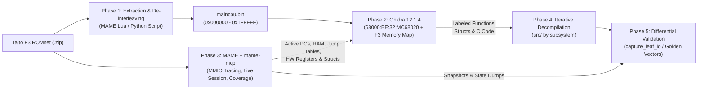

# Taitof3Decomp — Taito F3 Arcade Decompilation Project

<p align="center">
  
</p>

<p align="center">
  <strong>Reverse Engineering & Decompilation Framework for the Taito F3 System Architecture (Motorola MC68EC020)</strong>
</p>

<p align="center">
  <a href="#overview">Overview</a> •
  <a href="#progress">Progress</a> •
  <a href="#architecture--workflow">Workflow</a> •
  <a href="#hardware-specifications">Hardware Specs</a> •
  <a href="#mcp-tooling">MCP Tooling</a> •
  <a href="#repository-layout">Repository Layout</a> •
  <a href="#quick-start">Quick Start</a> •
  <a href="#legal-notice">Legal Notice</a>
</p>

---

## Overview

**Taitof3Decomp** is a structured decompilation and reverse engineering framework targeting arcade games built on the **Taito F3 System** motherboard (1992–1998). Powered by a 32-bit **Motorola MC68EC020 @ 16 MHz** CPU, this hardware platform hosted some of the most influential titles of the 90s arcade era, including:

- 🚀 *Darius Gaiden*
- 🏢 *Elevator Action Returns*
- 🔮 *Puzzle Bobble 2 / 3 / 4* & *Bubble Bobble II*
- ⚡ *RayForce / Gunlock*
- 💎 *Cleopatra Fortune*
- 🥊 *Kaiser Knuckle*

The framework implements a closed-loop verification pipeline connecting **static binary analysis in Ghidra 12.1.4** with **dynamic emulation in MAME** via the Model Context Protocol (MCP), utilizing `astrobleem/mame-mcp` and `clearbluejar/pyghidra-mcp`.

---

## Progress

<!-- coverage:start -->
### Decompilation progress — Darius Gaiden (`dariusg`)

**100.0% decompiled · 0.0% remaining**  
`████████████████████████████████████████`

| | functions | code bytes | % of code in functions |
|---|---:|---:|---:|
| Decompiled to C | 2606 / 2606 | 325,124 / 325,124 | **100.0%** |
| …of which verified bit-exact vs MAME | 2591 | 322,024 | 99.0% |
| **Remaining** | 0 | 0 | **0.0%** |

Per-bank map: [`docs/COVERAGE.md`](docs/COVERAGE.md). Code bytes = instruction bytes of the 2606 Ghidra functions in maincpu (325,124 of 403,578 disassembled bytes; the rest is code Ghidra has not assigned to a function yet). A function counts as decompiled when its entry address is annotated `ROM 0x…` in `src/`. Regenerate with `make coverage`.
<!-- coverage:end -->

---

## Architecture & Workflow

> **Committing is not publishing.** The progress numbers above only reach GitHub
> when the branch is pushed. Run `make publish` before reporting a block as done:
> it refuses to push with uncommitted changes and prints the remaining lead.
> `git status -sb` showing `ahead N` means the work is still local only.

The core strategy revolves around iteratively decompiling 68EC020 machine code into human-readable, matching C code verified against live dynamic execution states:



---

## Hardware Specifications

For an in-depth breakdown of the memory space and custom ASIC register maps, refer to [`docs/TAITO_F3_HW_MAP.md`](docs/TAITO_F3_HW_MAP.md).

| Component | Technical Details |
|---|---|
| **Main CPU** | Motorola **MC68EC020** @ 16 MHz (32-bit data bus, 24-bit address space: `0x000000`–`0xFFFFFF`) |
| **Ghidra Language ID** | `68000:BE:32:MC68020` |
| **Work RAM** | 128 KiB located at `0x400000`–`0x41FFFF` (mirrored at `0x420000`–`0x43FFFF`) |
| **Video Subsystem** | Multi-layer tilemaps, 64 KiB Sprite RAM, Line RAM raster effects (scroll/zoom/alpha blending), 24-bit Palette (8,192 colors) |
| **Audio Subsystem** | Motorola 68000 @ 16 MHz + Ensoniq ES5505 / ES5510, interfaced via 2 KB DPRAM (`MB8421`) |
| **Control / I/O** | MMIO at `0x4A0000`–`0x4A001F`: Inputs P1-P4, Watchdog, serial EEPROM 93C46 |

---

## MCP Tooling

This environment integrates two dedicated MCP servers enabling AI agents and reverse engineers to orchestrate Ghidra and MAME concurrently:

1. **`mame-mcp`** ([`astrobleem/mame-mcp`](https://github.com/astrobleem/mame-mcp)):
   - Live memory inspection and modification (`read_memory`, `write_memory`).
   - Dynamic MMIO tracing and runtime breakpoints.
   - Execution of MAME Lua scripts for automated binary dumping and golden vector capture.

2. **`pyghidra-mcp`** ([`clearbluejar/pyghidra-mcp`](https://github.com/clearbluejar/pyghidra-mcp)):
   - Headless Ghidra 12.1.4 automation.
   - On-demand decompilation to pseudo-C, symbol labeling, and struct creation.
   - Semantic code search and function graph navigation.

Check [`.mcp.json.example`](.mcp.json.example) for configuration details.

---

## Repository Layout

```
Taitof3Decomp/
├── PLAN.md                   # Complete step-by-step master decompilation plan
├── docs/
│   ├── TAITO_F3_HW_MAP.md    # Full hardware & memory map reference
│   └── assets/
│       └── banner.png        # Official project widescreen banner
├── .mcp.json.example         # Template for MCP server configuration
├── ghidra_proj/              # Base Ghidra project workspace (taito_f3)
├── scripts/                  # Extraction, de-interleaving and helper scripts
├── src/                      # Decompiled C source code (per game / subsystem)
├── traces/                   # Dynamic execution traces and MMIO logs
├── states/                   # Deterministic MAME savestates
├── tests/                    # Differential verification tests (golden vectors)
└── work/                     # Scratch workspace and intermediate artifacts
```

---

## Quick Start

### Prerequisites

- **Linux** (tested on Arch Linux)
- **Ghidra 12.1.4** with JDK 21
- **MAME** (recent version with Lua support enabled)
- **Python 3.12+** and package manager [`uv`](https://github.com/astral-sh/uv)

### Setup

1. Clone the repository with submodules:
   ```bash
   git clone --recurse-submodules https://github.com/DanimanX/Taitof3Decomp.git
   cd Taitof3Decomp
   ```

2. Configure your local MCP environment:
   ```bash
   cp .mcp.json.example .mcp.json
   # Adjust paths in .mcp.json to match your local Ghidra and MAME binaries
   ```

3. Review the execution phases outlined in [`PLAN.md`](PLAN.md).

---

## Legal Notice

> [!IMPORTANT]
> This project does not contain, host, or distribute copyrighted game ROMs, proprietary binaries, or assets owned by Taito Corporation. All target game files must be legally acquired by the end user from their own physical arcade boards or cartridges exclusively for historical preservation, study, and research purposes.
