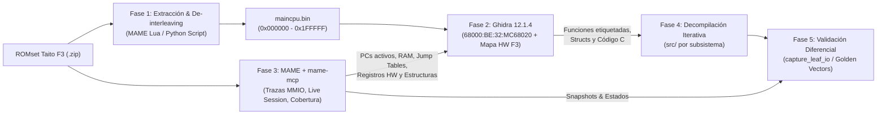

# Taitof3Decomp — Taito F3 Arcade Decompilation Project

<p align="center">
  
</p>

<p align="center">
  <strong>Framework de Decompilación e Ingeniería Inversa para la arquitectura arcade Taito F3 System (Motorola MC68EC020)</strong>
</p>

<p align="center">
  <a href="#descripción-general">Descripción</a> •
  <a href="#arquitectura-del-flujo-de-trabajo">Flujo de Trabajo</a> •
  <a href="#especificaciones-de-hardware">Hardware F3</a> •
  <a href="#herramientas-y-mcp">Herramientas MCP</a> •
  <a href="#estructura-del-repositorio">Estructura</a> •
  <a href="#guía-rápida-de-inicio">Inicio Rápido</a> •
  <a href="#aviso-legal">Aviso Legal</a>
</p>

---

## Descripción General

**Taitof3Decomp** es un entorno estructurado de decompilación e ingeniería inversa centrado en los títulos arcade de la plataforma **Taito F3 System** (1992–1998). Impulsada por una CPU de 32 bits **Motorola MC68EC020 @ 16 MHz**, esta placa albergó algunos de los títulos más legendarios de los salones recreativos, incluyendo:

- 🚀 *Darius Gaiden*
- 🏢 *Elevator Action Returns*
- 🔮 *Puzzle Bobble 2 / 3 / 4* & *Bubble Bobble II*
- ⚡ *RayForce / Gunlock*
- 💎 *Cleopatra Fortune*
- 🥊 *Kaiser Knuckle*

El proyecto implementa un bucle cerrado entre **análisis estático en Ghidra 12.1.4** y **análisis dinámico con MAME** mediante el protocolo Model Context Protocol (MCP), utilizando `astrobleem/mame-mcp` y `clearbluejar/pyghidra-mcp`.

---

## Arquitectura del Flujo de Trabajo

El objetivo es transformar el código binario del 68EC020 en C legible y verificable mediante oráculos dinámicos:



---

## Especificaciones de Hardware

Para una descripción exhaustiva del mapa de memoria y controladores de video/audio, consultar [`docs/TAITO_F3_HW_MAP.md`](docs/TAITO_F3_HW_MAP.md).

| Componente | Especificación Técnica |
|---|---|
| **CPU Principal** | Motorola **MC68EC020** @ 16 MHz (Bus de datos 32-bit, Direcciones 24-bit: `0x000000`–`0xFFFFFF`) |
| **Idioma Ghidra** | `68000:BE:32:MC68020` |
| **Work RAM** | 128 KiB en `0x400000`–`0x41FFFF` (con mirror en `0x420000`–`0x43FFFF`) |
| **Subsistema Gráfico** | Tilemaps multicapa, Sprite RAM (64 KiB), Line RAM raster effects (scroll/zoom/alpha), Paleta 24-bit (8192 colores) |
| **Subsistema de Audio** | Motorola 68000 @ 16 MHz + Ensoniq ES5505 / ES5510, acoplado mediante DPRAM de 2 KB (`MB8421`) |
| **Control / I/O** | MMIO en `0x4A0000`–`0x4A001F`: Inputs P1-P4, Watchdog, EEPROM serial 93C46 |

---

## Herramientas y MCP

El proyecto integra dos servidores MCP para permitir que agentes de IA e ingenieros de reversa interactúen simultáneamente con Ghidra y MAME:

1. **`mame-mcp`** ([`astrobleem/mame-mcp`](https://github.com/astrobleem/mame-mcp)):
   - Inspección y modificación de memoria (`read_memory`, `write_memory`).
   - Trazas de ejecución MMIO en caliente y breakpoints dinámicos.
   - Ejecución de scripts MAME Lua para extracción de dumps y golden vectors.

2. **`pyghidra-mcp`** ([`clearbluejar/pyghidra-mcp`](https://github.com/clearbluejar/pyghidra-mcp)):
   - Automatización de análisis headless con Ghidra 12.1.4.
   - Descompilación a pseudo-C en demanda, etiquetado de símbolos y tipos de datos.
   - Búsqueda semántica y navegación de funciones.

Ver [`.mcp.json.example`](.mcp.json.example) para la configuración de conexión.

---

## Estructura del Repositorio

```
Taitof3Decomp/
├── PLAN.md                   # Plan maestro detallado paso a paso
├── docs/
│   ├── TAITO_F3_HW_MAP.md    # Mapa de hardware y memoria completo
│   └── assets/
│       └── banner.png        # Banner oficial del proyecto
├── .mcp.json.example         # Plantilla de configuración de servidores MCP
├── ghidra_proj/              # Proyecto base de Ghidra (taito_f3)
├── scripts/                  # Scripts de extracción, de-interleaving y ayuda
├── src/                      # Código fuente decompilado (por subsistema / juego)
├── traces/                   # Trazas de ejecución y logs MMIO
├── states/                   # Savestates de MAME para reproducción determinista
├── tests/                    # Tests de validación diferencial (golden vectors)
└── work/                     # Espacio de trabajo temporal y artefactos intermedios
```

---

## Guía Rápida de Inicio

### Requisitos Previos

- **Linux** (probado en Arch Linux)
- **Ghidra 12.1.4** con JDK 21
- **MAME** (versión reciente con soporte Lua habilitado)
- **Python 3.12+** y gestor de paquetes [`uv`](https://github.com/astral-sh/uv)

### Configuración

1. Clonar el repositorio:
   ```bash
   git clone https://github.com/DanimanX/Taitof3Decomp.git
   cd Taitof3Decomp
   ```

2. Configurar el entorno MCP:
   ```bash
   cp .mcp.json.example .mcp.json
   # Ajustar rutas en .mcp.json según tu instalación local de Ghidra y MAME
   ```

3. Seguir el plan maestro en [`PLAN.md`](PLAN.md) para la fase correspondiente.

---

## Aviso Legal / Legal Notice

> [!IMPORTANT]
> Este proyecto no incluye ni distribuye ROMs comerciales, binarios protegidos por derechos de autor ni código propietario de Taito Corporation. Todos los archivos de juego deben ser provistos por el usuario final a partir de sus propios cartuchos o placas originales para propósitos exclusivos de investigación y preservación histórica.
